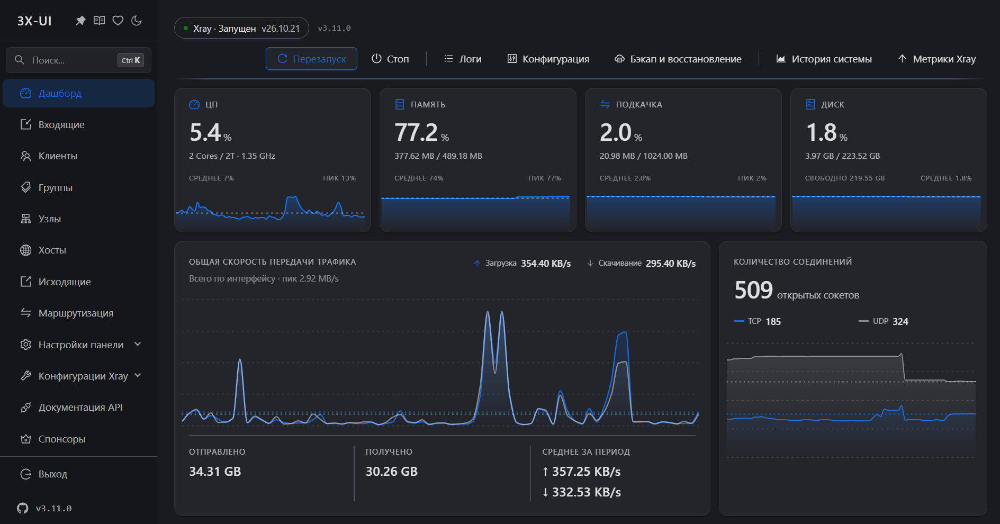

# 3x-ui для Keenetic ARM64 / Entware

Адаптированная версия **3x-ui v3.11.0** для роутеров Keenetic с архитектурой **ARM64 (aarch64)** и установленным **Entware**.

Протестировано на **Keenetic Ultra (KN-1811) EAEU**.

Установка проверена в тестовом ARM64-окружении с Entware. Успешно протестированы установка панели, запуск 3x-ui и Xray 26.10.21.

## 📦 Чистая установка (для обновления 3x-ui читай ниже)

Подключитесь к Keenetic по SSH и выполните:

```sh
opkg update
opkg install bash curl libcurl unzip coreutils
mkdir -p /opt/tmp
curl -fsSL https://raw.githubusercontent.com/larmaxval-cpu/3x-ui-keenetic-arm64/main/install.sh -o /opt/tmp/install-3x-ui.sh
sh /opt/tmp/install-3x-ui.sh
```

Установщик автоматически:

- Загружает исправленный бинарник из [релиза проекта](https://github.com/larmaxval-cpu/3x-ui-keenetic-arm64/releases/tag/v3.11.0-keenetic.1).
- Проверяет контрольную сумму SHA256.
- Устанавливает необходимые компоненты 3x-ui и Xray.

Перед использованием ознакомьтесь с [`install.sh`](install.sh).

## 🔄 Если 3x-ui уже установлен

Для перехода на адаптированную сборку необходимо **полностью удалить предыдущую установку 3x-ui**.

**1. Сохраните резервную копию (при необходимости).**

Создайте резервную копию настроек через интерфейс действующей панели и скачайте её на компьютер.

**2. Остановите старую панель.**

```sh
/opt/etc/init.d/S99x-ui stop
```

**3. Удалите старую установку.**

```sh
rm -rf /opt/etc/x-ui
rm -f /opt/etc/init.d/S99x-ui
rm -f /opt/bin/x-ui
```

**4. Установите адаптированную сборку.**

Выполните команды из раздела [«Установка»](#-установка).

**5. Восстановите настройки (при необходимости).**

Импортируйте сохранённую резервную копию через интерфейс новой панели.

> [!WARNING]
> Удаление каталога `/opt/etc/x-ui` уничтожает базу данных и настройки старой панели. Если они нужны, обязательно сохраните резервную копию до удаления.
>
> Переустанавливать Entware не требуется.

## 🖼️ Скриншот



## 🛠️ Что исправлено

- Корректное отображение свободного места на накопителе Keenetic.
- Корректный перезапуск панели в среде Entware.
- Совместимость служебного скрипта с различными расположениями `pidof`.
- Запуск панели без обязательного повышения приоритета процесса через `nice -n -19`.

## ⚙️ Управление

После установки команда управления панелью:

```sh
x-ui
```

Управление службой:

```sh
/opt/etc/init.d/S99x-ui start
/opt/etc/init.d/S99x-ui stop
/opt/etc/init.d/S99x-ui restart
```

Автозапуск выполняется через `/opt/etc/init.d/S99x-ui`.

## 📥 Скачать релиз

**[3x-ui v3.11.0-keenetic.1](https://github.com/larmaxval-cpu/3x-ui-keenetic-arm64/releases/tag/v3.11.0-keenetic.1)**

В релизе опубликованы:

- `xui-linux-arm64` — готовый бинарник для ARM64.
- `SHA256SUMS` — контрольные суммы файлов.

## ❤️ Поддержать проект

Если проект оказался полезен, можно поддержать его развитие.

**Альфа-Банк:** `2200 1535 1418 2378`
